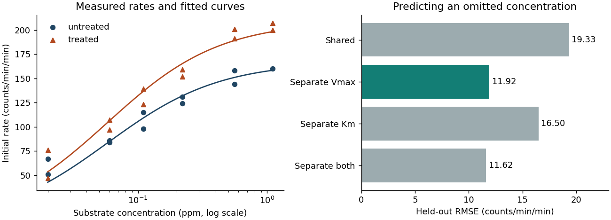

# Assay Evidence Lab

**Does a treatment change the plateau of an enzyme response, the substrate concentration at half-maximum, or both?** Explore 23 measured rates from a galactosyltransferase experiment, inspect four competing explanations, and trace each prediction to the observations used to test it.



## What the assay supports

Holding out one substrate concentration at a time, a model with separate apparent maximum rates reduced pooled prediction error from **19.33 to 11.92 counts/min/min**. Giving each condition its own half-saturation parameter as well reduced the error to **11.62**. We retain the three-parameter model as a descriptive reference. It captures most of the improvement with one additional parameter. The fourth parameter remains plausible.

| Parameters allowed to differ | Held-concentration RMSE | Interpretation |
|---|---:|---|
| Neither | 19.33 | A common saturation curve misses the separation at high concentration. |
| Apparent maximum rate | 11.92 | Fitted plateaus are 166.60 untreated and 208.63 treated, with shared half-saturation at 0.0580 ppm. |
| Apparent half-saturation | 16.50 | A horizontal shift alone describes the high-concentration observations less well. |
| Both | 11.62 | Lowest pooled error in this comparison. The gain over separate plateaus is 0.30 counts/min/min. |

### What would change the decision?

Each condition comes from a single experiment. Treatment and run therefore vary together. Independent preparations per condition would allow a test of whether the apparent plateau difference persists across runs. Concentrations around the apparent half-saturation region would help resolve the smaller difference between the two leading models. The observations contain neither an equilibrium binding measurement nor an active enzyme concentration. Inferring a dissociation constant or molecular turnover number would require additional evidence.

## Reproduce or use your own assay

Tested with Python 3.12. From the repository root in an activated virtual environment:

```sh
python -m pip install -r requirements.txt
python kinetics/model.py
python kinetics/figure.py
python -m unittest discover -s kinetics
python NucleusAudit/train.py
python NucleusAudit/verify.py
```

To review a second assay, use the example CSV schema with columns `conc,rate,state`. Provide positive finite substrate concentrations and initial rates, both states labeled `treated` and `untreated`, and at least three common concentration levels. Keep units consistent and record them with the input. The figure script is specific to the published example.

```sh
python kinetics/model.py --csv my_assay.csv --out my_results
```

The fit uses positive parameters, equal observation weights and nonlinear least squares on the original rate scale. Each of six folds omits **all** observations at one concentration in both conditions. Endpoint folds evaluate limited extrapolation. Interior folds evaluate interpolation. Model selection and reporting use the same folds, so the comparison is exploratory. File-level predictions allow independent recalculation of the pooled RMSE. Parameter order in the export is untreated Vmax and Km, then the treated Vmax and/or Km when allowed to differ. Fold errors follow increasing concentration.

[Input measurements](kinetics/puromycin.csv) · [Fitted parameters and fold errors](kinetics/fits.json) · [Held-out predictions](kinetics/predictions.csv) · [Related work and applications](LANDSCAPE.md)

## Second case study · NucleusAudit

A separate supervised learning benchmark tests how removing direct nuclear-size descriptors affects prediction on 114 held-out cytology specimens. The 30-feature classifier reached ROC-AUC 0.9901 and missed two positive specimens. Exported weights can be replayed independently. [Read the model report and error analysis](NucleusAudit/README.md).

## Data and contribution record

The enzyme measurements originate from M. A. Treloar's 1974 thesis on galactosyltransferase in Golgi membranes, included in R's Puromycin dataset and distributed as CSV by Rdatasets. Source units are ppm and counts/min/min. Row numbers preserve the source order. [R dataset documentation](https://stat.ethz.ch/R-manual/R-devel/library/datasets/html/Puromycin.html) · [CSV source](https://github.com/vincentarelbundock/Rdatasets/blob/master/csv/datasets/Puromycin.csv)

The reference implementation and interpretation were prepared with AI assistance. To add a personal technical contribution, record a prediction before reanalysis, implement one sensitivity check, commit the resulting fold-level table, and explain whether the change alters the decision. One concrete question is whether averaging squared errors equally across concentrations changes the model ranking when the final concentration has fewer observations.
