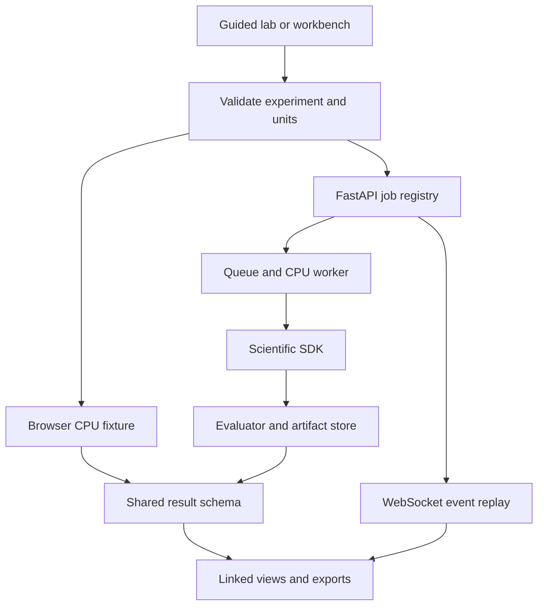

# Assay Evidence Studio • platform design

**Design review, phases 1–2.** The thesis question is whether a mechanistic constraint or a learned feature improves prediction on an unseen experimental unit, and whether the improvement survives a change of measurement conditions. A result in one assay cannot validate a result in another. The shared product is the experiment record, with a question, reference, baseline, held-out unit, uncertainty statement and reproducible figure.

## 1. Current system and gaps

| Track | Observed implementation | Next engineering deliverable | Acceptance evidence |
|---|---|---|---|
| Thesis | Four positive-parameter kinetics models in kinetics/model.py. Golub training and test cohorts are separated before probe selection in research/expression.py. Tomography uses simulated measurements from predicted backbones. | Add an analytic solver oracle, independent-unit split registry and per-run assumptions. | Held-out predictions, residuals, invariant-test results and a record of unsuccessful settings downloadable together. |
| Open source | Separate Python analyses, JavaScript engines, scientific checks and a contribution guide. Reproducible demos execute on CPU. | Wrap existing implementations behind typed array contracts. Pin input hashes and rerun one fixture through Python and browser on every release. | Fresh checkout reproduces the fixture within a declared tolerance. Fail on unit mismatch or specimen leakage. |
| Product | Static labs run locally and export figures/data in several formats. | Add durable job state, streamed progress and portable manifests for larger jobs. | Disconnect, reconnect and replay by event number. Repeated submission with the same input fingerprint retrieves the same completed result. |

### Proposed service boundary

The static site remains independently usable. An optional service handles long CPU jobs. The scientific SDK owns the equations. Transport and rendering consume versioned results.



### Repository layout and ownership

```text
kinetics/                 existing fits, tests and figures
research/                 existing cohort and classifier benchmarks
evidence/                 existing scientific audit and checks
studio/                   existing CPU labs and visualization
docs/platform-design.md   this specification
src/assay_evidence/       proposed installable SDK
  featurizers/            units, probe alignment, coordinate subsets
  models/                 fit/predict adapters and learned baselines
  simulators/             pure numerical transitions and trajectory output
  evaluators/             split registry, metrics and calibration
  records/                versioned experiment and result schemas
services/jobs/            proposed API, queue, events and storage adapters
tests/reference/          proposed analytic fixtures and cross-runtime tests
```

**Contracts.** A feature batch carries values, ordered feature IDs, specimen IDs, units, missingness mask and source digest. A fit consumes training IDs and a frozen configuration. A prediction carries IDs in input order, value, model digest and an uncertainty object with method, population and calibration count. Missing calibration is explicit. Structural selections use accession, model version, chain and residue ID including insertion code. Stable keys connect sequence, contact map and viewport across filtering or camera movement.

**Run lifecycle.** POST /jobs validates dimensions, array bounds, units, finite values and resource limits before enqueue. Hash canonical configuration, source bytes, software revision and seed for the cache key. Workers claim jobs atomically and write artifacts to temporary keys. Publish a manifest after all checks pass. Terminal states are succeeded, failed and cancelled. GET /jobs/{id} returns state and artifact digests. WebSocket events include job ID and increasing sequence number. Authorize artifact reads with the same scope as job access. Export model version, dataset license, split IDs, machine class, wall time, units and solver tolerance. SHA-256 enables comparison to a trusted digest. Signing the manifest with a separately managed key is a later authenticity control.

## 2. Mathematical specification and benchmark protocol

### Assay kinetics and conservation

For substrate S in concentration units and time t, use v(S)=Vmax S/(Km+S), dS/dt=−v, dP/dt=v. Vmax has concentration/time units, Km has concentration units. Fit apparent initial rates by minimizing the sum of squared rate residuals with positive parameters. Supply weights only when measurement variances are documented. Compare shared parameters, condition-specific Vmax, condition-specific Km and both varying on identical splits. Use the bundled 23-row Puromycin initial-rate dataset for rate prediction. The depletion curve is a separate synthetic experiment; rate rows do not supply measured progress curves.

For initial S0>0 the analytic oracle satisfies S−S0+Km log(S/S0)=−Vmax t. Solve implicitly or compare a numerical ODE against this relation. At S0=0 use the zero-flux boundary. Test S,P ≥ 0 and S+P=S0+P0 to within 1e−8 times the initial total plus 1e−12 in the declared units for float64 reference fixtures. Reject negative inputs. If a solver step crosses zero, retry with a smaller step and record the retry. Do not silently clip an invalid trajectory. Benchmark against a constant training-mean rate and a linear initial-rate model. Leave out one concentration level at a time across conditions, keeping all replicates together. Report fold-level MAE in the original rate units and signed residuals by condition.

### Structure and imaging

Use matching alpha-carbon coordinates in ångströms. For matched reference X and comparison Y, minimize RMSD = sqrt(mean_i ||R x_i + t − y_i||²) over proper rotations and translations (det R=+1). Record matched count, chain mapping and missing positions. Reject ambiguous matches and flag degenerate alignments. Contact-map value D_ij=||x_i−x_j|| is invariant to a common rigid transformation. Display distance and sequence separation on selection. A geometric contact is a proximity measurement; chemical bond assignment requires additional atom information. Use known rigid transforms of bundled structures as unit tests with RMSD < 1e−6 Å after alignment. Measure conformational change only when comparable structures or frames exist.

For tomography let x be the normalized backbone-density slice and A the discretized projection operator. Generate y=Ax and compare reconstructed densities with RMSE=sqrt(sum_j(xhat_j−x_j)²/N). Bundle scan angles, pixel spacing, normalization and iteration count. The current 40 central-slice runs are five independent structures measured repeatedly. Hold out all runs for a protein together. Compare the angle-conditioned training mean with the nearest training structure by mean reference density. Declare access to the reference-derived feature; also evaluate without it for use cases where only projections are available. Test a shifted detector grid as a separate simulation condition to assess sensitivity to using an identical forward and inverse discretization.

### Expression, explanation and uncertainty

Use original Golub partitions (38 training, 34 independent test specimens, 7,129 probe sets). Fit feature selection, scaling and model parameters within each training fold during development. Freeze settings before final evaluation. An already inspected historical test set supports retrospective replication; future claims require a fresh external cohort. Compare a class-prior baseline to the existing Gaussian naive Bayes, shrinkage LDA and nearest centroid. Record sensitivity, specificity, balanced accuracy=(sensitivity+specificity)/2, AUROC and confusion counts. Report undefined metrics for a missing class. A training-selected probe's cohort contrast is mean AML minus mean ALL in original intensity units. Keep probe accession distinct from gene identity.

For a linear decision score f(z)=b+wᵀz, use signed contributions w_j(z_j−z0_j) relative to a training-derived reference z0. Verify their sum equals f(z)−f(z0) within numerical tolerance. Display direction, probe ID, cohort contrast and fitted contribution separately. These are explanations of the fitted score, not causal effects. For multiclass scores fix the contrasted pair. For models without a linear score use held-out grouped permutation importance with a stated seed and repeated permutations.

For a continuous prediction, use disjoint fit/calibration/test units. Calibration scores are |y−f(x)|. With m exchangeable calibration units, let k=ceil((m+1)(1−alpha)); use the kth smallest score q, or infinity if k>m. Return [f(x)−q,f(x)+q], nominal level, realized coverage and median width. For repeated measurements within an independent unit use the maximum residual per unit if simultaneous unit-level coverage is intended. Five proteins cannot support a finite distribution-free 90% split-conformal interval under this protocol. Report the limitation explicitly. For class labels use scores 1−p(true class) from a probability-producing model and include labels satisfying 1−p(label)≤q. Keep calibration independent of model selection. Predicted structural confidence has different semantics.

When replicate experiments and independently fitted models exist, estimate mean within-condition replicate variance and across-fit prediction variance separately. State sampling design and replicate counts. Their sum is interpretable as predictive variance only under the stated conditional variance model; overlapping simulation runs do not identify experimental noise.

### Release evidence

| Comparison | Primary endpoint | Required diagnostic |
|---|---|---|
| Shared vs condition-specific kinetics | Concentration-held-out MAE | Parameter estimates, residuals and mass-balance drift |
| Prior vs expression classifiers | Independent-specimen balanced accuracy | Confusion matrix, class counts and paired specimen predictions |
| Mean vs nearest-structure error prediction | Held-out protein MAE | Per-protein errors across angles, feature availability and grid shift |
| CPU reference vs accelerated implementation | Numerical agreement at matched tolerance | Cold/warm latency, peak memory, hardware, batch size and repeat count |

Publish measured timings with input size and hardware. Compute cost per 1,000 completed runs as 1000 × measured billable cost / completed runs, including failed attempts in cost. Leave monetary cost unavailable until actual billing data exist. Avoid pooling measured patient data and synthetic trajectories into one performance number.

### References

- [Puromycin dataset and measurement definitions](https://stat.ethz.ch/R-manual/R-devel/library/datasets/html/Puromycin.html)
- [Golub et al., original classification study](https://doi.org/10.1126/science.286.5439.531)
- [Angelopoulos, Barber and Bates, Theoretical Foundations of Conformal Prediction](https://arxiv.org/abs/2411.11824)
- [AlphaFold Protein Structure Database](https://alphafold.ebi.ac.uk/)
